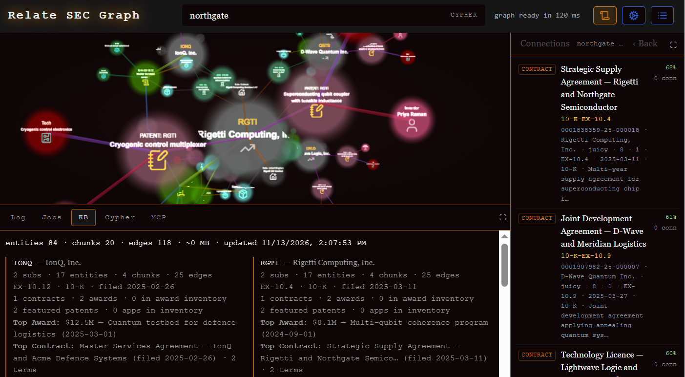

# Relate SEC Graph

[](LICENSE)
[](https://relatedb.ai)
[](https://www.python.org)
[](https://neo4j.com/blog/graph-database/announcing-the-relate-by-neo4j-hackathon-2026-build-ai-agents-on-an-embedded-graph-database/)

**SEC contracts, USPTO patents and federal awards, turned into one knowledge graph you can
explore in 3D or ask questions in plain language — running on
[Relate](https://relatedb.ai), an embedded graph database. No server. No Docker. No
connection string.**



> **Status:** complete and running. The graph ships pre-built in `data/graph/`, so you can
> clone this repo and have the app up in about two minutes. The ingest pipeline is private —
> see [What's not here](#whats-not-here).

> *"I've run this same app on three graph databases. Relate is the only one that needs no
> server — which is why it's the one I'd actually hand to a customer."*

---

## The problem

If you want to understand a company, the paperwork is where the truth is — but it's
scattered across three government systems, in three formats, and none of them talk to each
other.

- **SEC EDGAR** holds the contracts. Who they signed with, for how much, under what terms.
- **USPTO** holds the patents. What they actually own, and who invented it.
- **USASpending** holds the federal awards. Who the government pays, and for what.

Answering one real question — *"who does this company depend on, and what do they own?"* —
means opening dozens of filings and cross-referencing them by hand.

This app does that once, stores the result as a graph, and lets you ask.

## What you get

- **A 3D map** of companies, contracts, patents, inventors, technologies and awards.
- **Semantic search** — type a question, get the nodes that answer it.
- **Cypher** — write a graph query and watch the results land on the map.
- **Every fact links back to its source text.** No unsourced claims.
- **An MCP server**, so an agent can query the same graph the UI is showing.

## Demo

A 90-second walkthrough, screen-recorded on a 16 GB laptop — linked from the Devpost
submission. Four moments worth watching for:

| # | Moment | What it proves |
|---|---|---|
| 1 | `graph ready in 69 ms` in the top bar | No database to start. Nothing to boot. |
| 2 | One Cypher statement doing traversal **+** vector **+** full-text | Graph, meaning and keywords in a single query |
| 3 | An agent querying the graph over MCP | The app *is* the MCP server |
| 4 | A row cap truncating a result, in-band | Guardrails an agent can actually see |

## Measured, not claimed

All numbers from the 16 GB dev laptop, against the committed store. Reproduce them with
`scripts/measure_footprint.py`.

| | Measured | Note |
|---|---|---|
| **Store on disk** | **311 KB** (9 files) | 16 KB without vectors |
| **Engine cold start** | **15–17 ms** | import → connect → first query |
| **Store open** (UI badge) | **69 ms** | what `/health` reports as `open_ms` |
| **Backend cold start** | 1.2–2.3 s | FastAPI/pydantic import — *not* the database |
| **Backend RSS** | 60 MB | after serving `/graph` |
| **Hybrid query** | 4–15 ms, 8 rows | vector + BM25 + fusion + graph hop |
| **Graph** | 109 nodes · 118 edges · 20 chunks | |

For contrast: the Memgraph build needs Docker Desktop — 2–4 GB of RAM just to exist —
plus a container, a port and a connection string, before the app starts.

## Quickstart

Requires **Python 3.11+** and **Node 18+**. No database server, no Docker.

```powershell
# 1. Python deps (a venv keeps it clean)
python -m venv .venv
.venv\Scripts\python.exe -m pip install -r requirements.txt

# 2. Run the backend — it opens data/graph/ and listens on :8020
.venv\Scripts\python.exe -m llm_app.main

# 3. In a second terminal, run the UI
cd ui
npm install
npm run dev
```

Open the UI at **http://localhost:5188**.

Or just double-click **`start.bat`** — it checks the venv and `node_modules`, then opens both
windows for you.

The graph lives at `data/graph/` — a Relate **directory store**, committed to this repo.
Point `RELATE_DB_PATH` somewhere else to open a different one.

The 3D map and Cypher work with **no API keys**. Semantic search needs `OPENAI_API_KEY`,
because the graph's vectors are `text-embedding-3-small` and the query has to be embedded
with the same model.

With a key, `scripts/hybrid_demo.py` shows the interesting part: one Cypher statement that
ranks chunks by meaning **and** by keyword, fuses the two rankings, then walks to the
entities each chunk mentions.

```powershell
.venv\Scripts\python.exe scripts\hybrid_demo.py "exclusivity commitment quantum capacity"
```

### Check it before you trust it

```powershell
# read path against the shipped store (no server needed)
.venv\Scripts\python.exe scripts\verify_store.py

# boot the backend in-process and exercise every endpoint the UI calls
.venv\Scripts\python.exe scripts\smoke_http.py

# cold start, RAM and disk — the numbers in the table above
.venv\Scripts\python.exe scripts\measure_footprint.py
```

All exit non-zero on failure. `scripts/test_read_api.py` builds a throwaway fixture instead,
if you want to test the read functions without a store.

## What's in the graph

The committed store is a **demo graph**: five real hard-tech tickers (quantum, photonics,
future materials), with representative contracts, patents and awards generated to exercise
every code path in the app. The schema, the queries and the UI are identical to the
production graph — only the ingest pipeline that fills it is private.

| Node | What it represents |
|---|---|
| `TICKER` | A public company |
| `SUBSIDIARY` | A company it owns |
| `CONTRACT` | A material contract filed with the SEC |
| `DEAL_EVENT` | An announced deal with no contract filed |
| `CONTRACT_TERM` | A specific obligation inside a contract |
| `PATENT` | A patent it owns |
| `INVENTOR` | A person named on a patent |
| `TECHNOLOGY` | A technology area |
| `FEDERAL_AWARD` | A federal contract or grant |
| `PRODUCT` | What an award or contract was for |
| `Chunk` | The source text behind every fact (hidden from the map) |

Edges connect them: `HAS_CONTRACT`, `HAS_TERM`, `SUBSIDIARY_OF`, `HAS_PATENT`,
`INVENTED_BY`, `LEVERAGES_TECH`, `HAS_AWARD`, `AWARDED_BY`, `HAS_PRODUCT`, `COVERS`,
`BUYS`, and `MENTIONS` (chunk → entity).

If `data/graph/` is ever empty, `data/README.md` explains how to rebuild or replace it.

## How it works

```
┌──────────────────────────────────────────────┐
│  llm_app/main.py :8020      ← read-only      │
│  └─ llm_app/read_api.py     (vendored reads) │
│     └─ api/mgapp/storage.py (thread-safe)    │
│        └─ relate-db (in-process library)     │
│           └─ data/graph/  ← directory store  │
└─────────────┬────────────────────────────────┘
              │ HTTP
┌─────────────┴────────────────────────────────┐
│  ui/ (Vite) :5188                            │
└──────────────────────────────────────────────┘

Optional sidecar (read-only follower):
  relate serve --mcp stdio --database ./data/graph --read-only
```

No Docker. No database server. One folder.

## Built on Relate

Relate is an embedded graph database. It runs **inside** the app instead of beside it —
closer to SQLite than to a database server. This app leans on four things it does:

| | What it means here |
|---|---|
| **Embedded** | The graph is one folder. No Docker, no ports, no connection string. |
| **One statement, three searches** | A single Cypher statement mixes graph traversal, vector similarity and full-text search, fused by reciprocal rank. |
| **MCP built in** | `relate serve --mcp` exposes the graph to any agent — no adapter, no glue code. |
| **Agent guardrails** | Row caps with in-band truncation reports, safe mode that refuses unbounded reads, and typed errors that say whether a retry helps. |

Three Relate behaviours shaped the code, and all three are worth knowing if you extend it:

- **Connections are thread-affine.** FastAPI runs sync endpoints in a threadpool, so
  `api/mgapp/storage.py` funnels every query through one dedicated worker thread that owns
  the connection. A single global connection would raise under load.
- **A `.rl` file can't be read beside its writer.** A **directory** store can, which is why
  the graph ships as `data/graph/` and not `data/graph.rl` — it lets the MCP server read the
  store while the backend holds it.
- **The row cap is a CLI feature, not an engine feature.** `--agent-mode --max-rows` belongs
  to the CLI's one-shot query mode. Over MCP, a `read_cypher` call returns whatever the
  statement produces — so bound it yourself with `LIMIT`, or page with `SKIP`. The truncation
  report only appears where the cap is enforced.

## Tech stack

**Backend** — Python 3.11+, FastAPI, Pydantic, `relate-db` (the embedded engine),
`python-dotenv`, `openai` (query embeddings only).

**Frontend** — React 19, Vite 6, `react-force-graph-3d` + `three` for the 3D map,
`d3-force-3d` for layout, TanStack Query for data, Zustand for state, Tailwind 4,
`lucide-react` for icons.

**Database** — Relate 1.0.1, embedded, one directory store. No server process.

## What's not here

**The ingest pipeline is not in this repo.** It's proprietary — the parsing rules, the
extraction prompts and the quality checks that make the graph trustworthy took real work to
get right.

This repo ships a **pre-built graph** so you can run the demo end to end without it.

Because the store is read-only here, the write endpoints (`/ingest`, `/rebuild`,
`/truncate`, `/restore`, `/delete-ticker`) answer with **HTTP 501** and a message saying so,
rather than pretending to work. `/jobs` returns an empty list.

If you want to talk about how the pipeline works, I'm happy to walk through the design.

## License

AGPL-3.0. See `LICENSE`.

## Links

- [TECHREADME.md](TECHREADME.md) — architecture, every endpoint, measured resource usage
- [Relate docs](https://relatedb.ai/docs/llms.txt)
- [Relate on GitHub](https://github.com/relatedb/relate)
- [Relate hackathon](https://neo4j.com/blog/graph-database/announcing-the-relate-by-neo4j-hackathon-2026-build-ai-agents-on-an-embedded-graph-database/)
